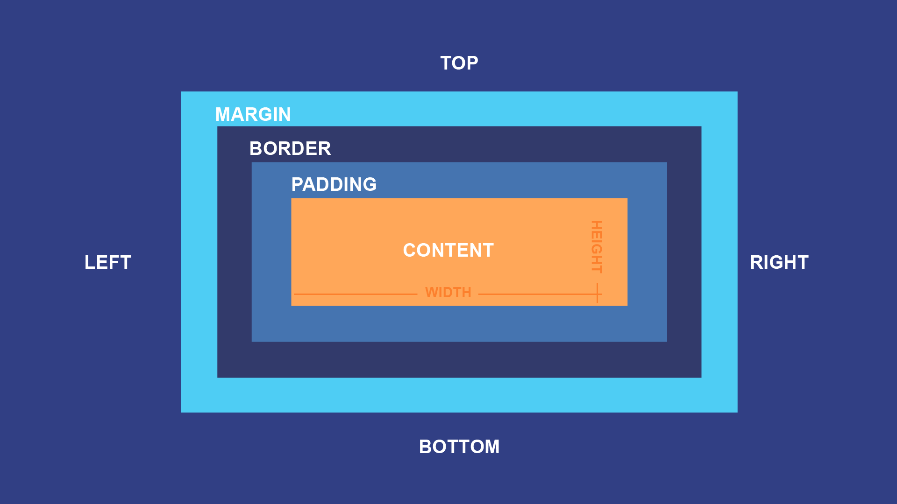

# Fase 1 – **Fundamentos de CSS**

---

### **1. ¿Qué es CSS y para qué sirve?**

CSS (Cascading Style Sheets) es el lenguaje que usamos para **dar estilo** a las páginas web creadas con HTML. Nos permite modificar colores, tipografías, márgenes, tamaños, posiciones y mucho más.

---

### **2. Cómo se aplica CSS**

CSS se puede aplicar de tres formas:

- **En línea (inline):** dentro de una etiqueta HTML
    ```html
    <p style="color: blue;">Texto azul</p>
    ```

- **Interno (en el mismo archivo HTML):**  
    ```html
    <style>
      p { color: blue; }
    </style>
    ```
    
- **Externo (recomendado):** en un archivo `.css` separado  
    **index.html**
    
    ```html
    <link rel="stylesheet" href="estilos.css">
    ```
    
    **estilos.css**
    
    ```css
    p {
      color: blue;
    }
    ```
    

---

### **3. Selectores básicos**

Los selectores indican **a qué elementos HTML** se le aplican los estilos:

- **Selector de etiqueta:**
    
    ```css
    h1 { color: red; }
    ```
    
- **Selector de clase:**
    
    ```css
    .destacado { background-color: yellow; }
    ```
    
- **Selector de ID:**
    
    ```css
    #titulo { font-size: 24px; }
    ```
    

**Ejemplo HTML:**

```html
<h1 id="titulo">Mi página</h1>
<p class="destacado">Texto importante</p>
```

---

### **4. Propiedades esenciales**

Algunas propiedades que debes conocer desde el inicio:

```css
body {
  background-color: #f0f0f0;
  color: #333;
  font-family: Arial, sans-serif;
  font-size: 16px;
  text-align: center;
}

h1 {
  margin: 20px;
  padding: 10px;
  border: 1px solid black;
}
```

---

### **5. Box Model**

Todos los elementos HTML son cajas que tienen:



- `margin`: espacio exterior
- `border`: borde del elemento
- `padding`: espacio interior
- `content`: el contenido real


--- 

**Ejemplo práctico:**

```css
.caja {
  width: 200px;
  height: 100px;
  padding: 10px;
  margin: 20px;
  border: 2px solid blue;
}
```

---

### **6. Unidades de medida**

Aprenderás a controlar tamaños usando diferentes unidades:

#### **1. Unidades absolutas**

### `px` – Píxeles (fijos)

```css
h1 {
  font-size: 24px; /* Tamaño fijo del texto */
}
```

### `cm`, `mm`, `in` – Unidades físicas (rara vez usadas)

```css
div {
  width: 10cm;
  height: 5cm;
}
```

---

#### **2. Unidades relativas al texto**

### `em` – Relativo al tamaño del elemento padre

```css
body {
  font-size: 16px;
}

h1 {
  font-size: 2em; /* 2 * 16px = 32px */
}
```

### `rem` – Relativo al tamaño del `<html>`

```css
html {
  font-size: 16px;
}

p {
  font-size: 1.25rem; /* 20px */
}
```

> [!tip] 📌 _Consejo: usar `rem` para texto y `em` para padding/margin internos es buena práctica._

---

#### **3. Unidades relativas al contenedor o viewport**

### `%` – Porcentaje respecto al contenedor

```css
.container {
  width: 100%;
}

.img-responsive {
  width: 50%; /* Mitad del contenedor */
}
```

### `vw`, `vh` – Relativo al ancho/alto del viewport

```css
.hero {
  width: 100vw;   /* 100% del ancho de la ventana */
  height: 60vh;   /* 60% de la altura visible */
}
```

---

#### **4. Unidades modernas útiles**

### `ch` – Ancho de un carácter (`0`)

```css
input {
  width: 20ch; /* suficiente para 20 caracteres aprox. */
}
```

### `ex` – Altura de la letra `x` (menos común)

```css
div {
  line-height: 2ex;
}
```

---

#### **Ejemplos combinados y aplicados**

###### 📦 Caja adaptable a móviles

```css
.card {
  width: 90%;
  max-width: 400px;
  padding: 1.5em;
  margin: 0 auto;
}
```

##### 🧱 Imagen de cabecera

```css
.hero {
  height: 60vh;
  background-size: cover;
}
```

##### 📝 Texto con escala fluida

```css
html {
  font-size: 100%; /* base = 16px */
}

body {
  font-size: 1rem;
}

@media (min-width: 768px) {
  body {
    font-size: 1.125rem;
  }
}

@media (min-width: 1024px) {
  body {
    font-size: 1.25rem;
  }
}
```

---

### 📏 **Tabla resumen de unidades de medida en CSS**

| **Unidad** | **Tipo**          | **Relación**                           | **Uso típico**                                 | **Ejemplo**          |
| ---------- | ----------------- | -------------------------------------- | ---------------------------------------------- | -------------------- |
| `px`       | Absoluta          | Píxeles de pantalla                    | Tamaños fijos de fuente, bordes, márgenes      | `font-size: 16px;`   |
| `cm`, `mm` | Absoluta          | Centímetros / milímetros               | Documentos impresos (raro en web)              | `width: 10cm;`       |
| `in`       | Absoluta          | Pulgadas (1in = 2.54cm)                | Documentos físicos                             | `height: 1in;`       |

---

| **Unidad** | **Tipo**          | **Relación**                           | **Uso típico**                                 | **Ejemplo**          |
| ---------- | ----------------- | -------------------------------------- | ---------------------------------------------- | -------------------- |
| `em`       | Relativa (fuente) | Al tamaño de fuente del elemento padre | Padding, márgenes, escalado interno            | `padding: 2em;`      |
| `rem`      | Relativa (raíz)   | Al tamaño de fuente del `<html>`       | Escalado consistente, accesibilidad            | `font-size: 1.5rem;` |
| `%`        | Relativa          | Al tamaño del elemento contenedor      | Anchos adaptables, altura de cajas             | `width: 80%;`        |

---

| **Unidad** | **Tipo**          | **Relación**                           | **Uso típico**                                 | **Ejemplo**          |
| ---------- | ----------------- | -------------------------------------- | ---------------------------------------------- | -------------------- |
| `vw`       | Viewport          | 1% del ancho visible del navegador     | Anchos responsivos de secciones o imágenes     | `width: 100vw;`      |
| `vh`       | Viewport          | 1% de la altura visible del navegador  | Alturas de secciones tipo "hero"               | `height: 60vh;`      |
| `vmin`     | Viewport          | 1% del lado más corto del viewport     | Tamaños equilibrados en cualquier orientación  | `font-size: 5vmin;`  |
| `vmax`     | Viewport          | 1% del lado más largo del viewport     | Elementos que deben adaptarse al espacio mayor | `width: 50vmax;`     |

---

| **Unidad** | **Tipo**          | **Relación**                           | **Uso típico**                                 | **Ejemplo**          |
| ---------- | ----------------- | -------------------------------------- | ---------------------------------------------- | -------------------- |
| `ch`       | Relativa (texto)  | Al ancho del carácter `0` del elemento | Inputs, alineación de texto monoespaciado      | `width: 40ch;`       |
| `ex`       | Relativa (texto)  | Altura de la letra `x` del elemento    | Casos muy específicos de tipografía            | `line-height: 2ex;`  |

---

### Sugerencias de uso

- Usa `rem` para **tamaños de texto** escalables.
- Usa `%`, `vw`, `vh` para **diseños responsivos**.
- Usa `em` para **padding/margin** relativo al texto del propio componente.
- Usa `px` si necesitas precisión en elementos pequeños.

---
### **Mini-proyecto sugerido**

**Ficha de personaje**

Crea una tarjeta que incluya:

- Nombre
- Imagen
- Descripción
- Datos como nivel, puntos, etc.
    

Usa clases e IDs, aplica estilos básicos, trabaja con el box model y utiliza varias unidades (`px`, `%`, `em`).

[[Solución proyecto -Ficha de personaje-]]
